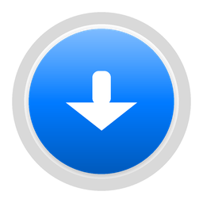
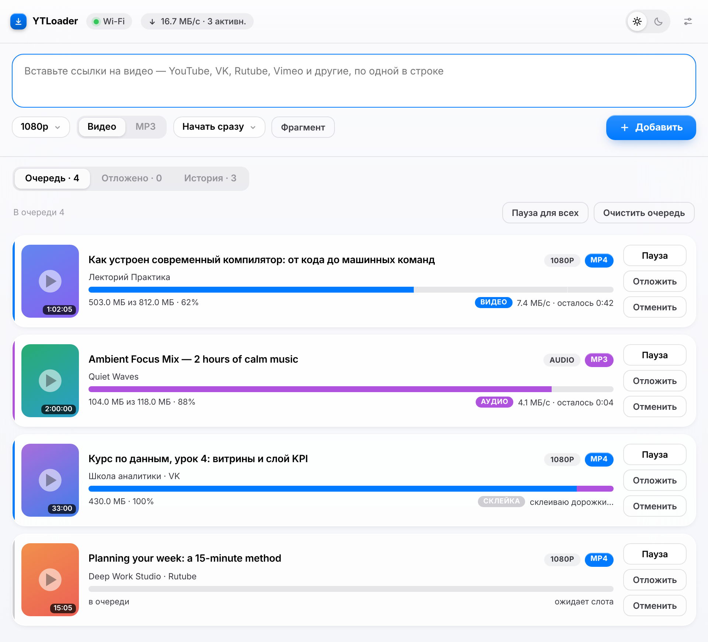
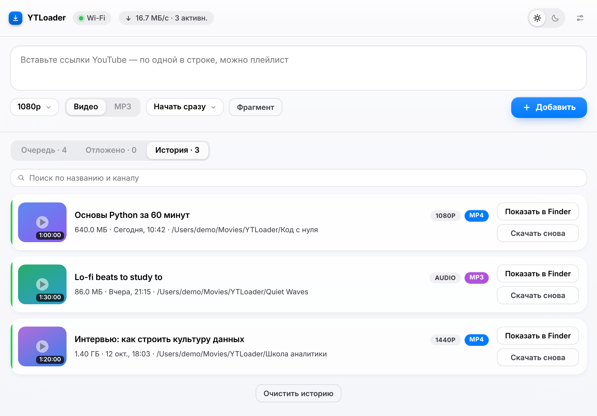
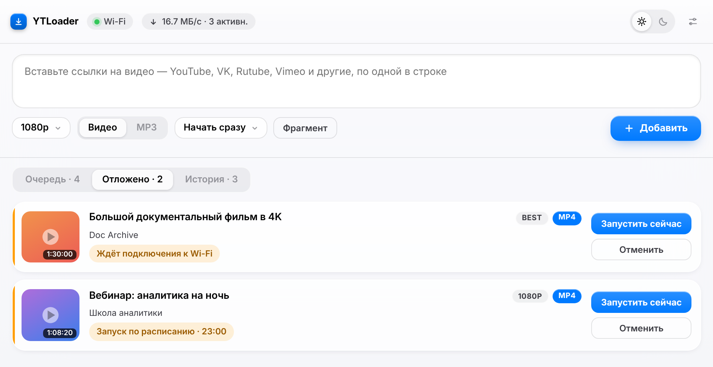
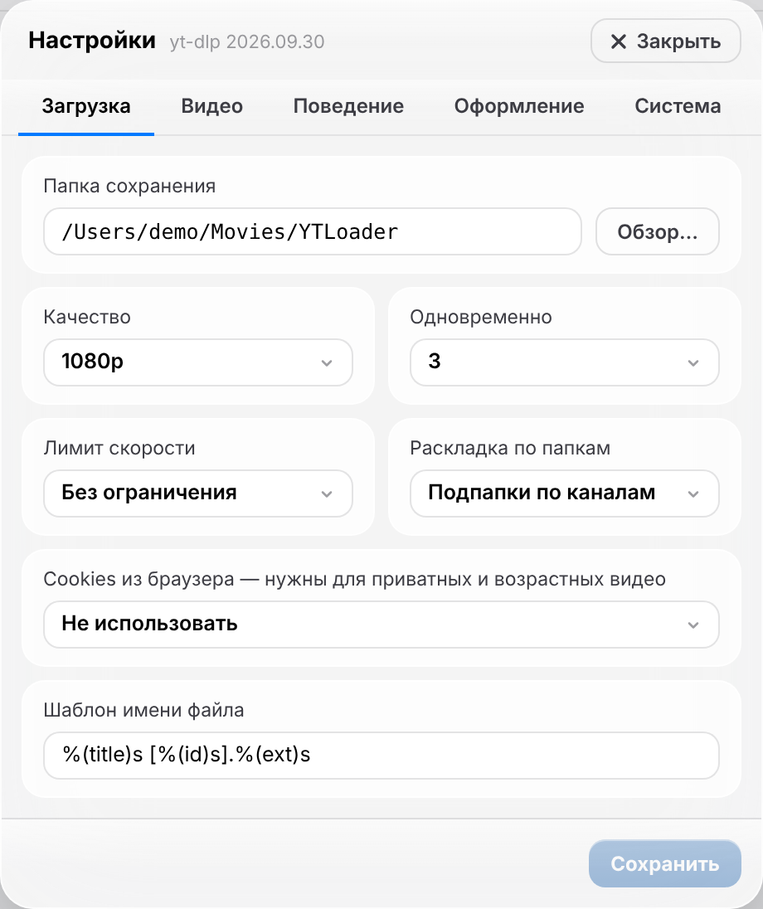
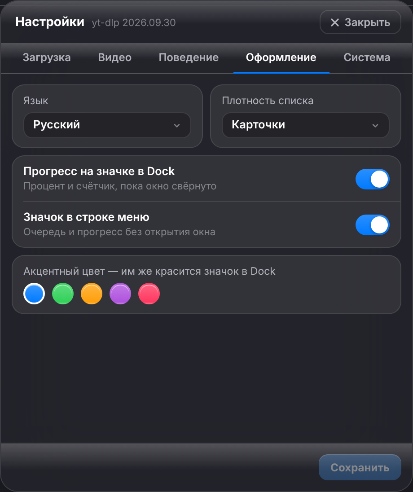
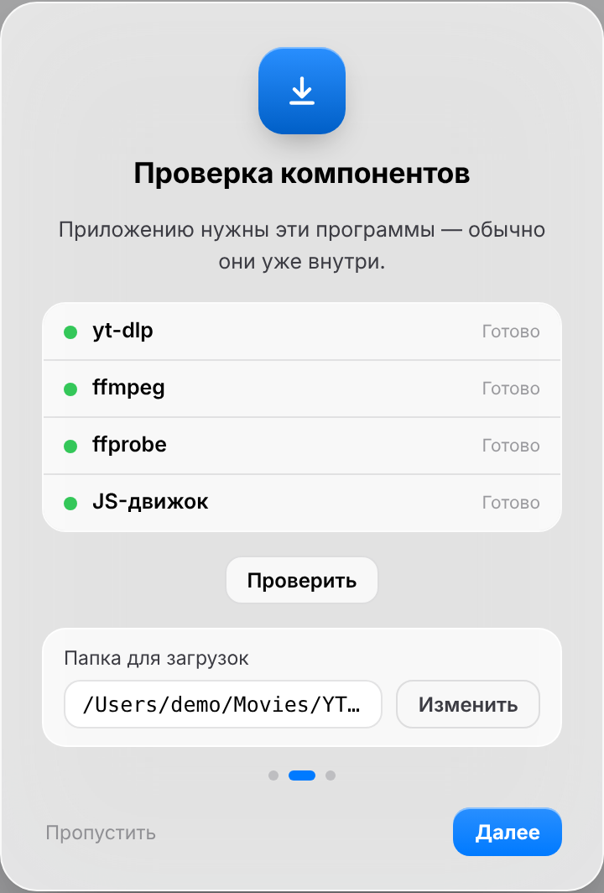

<p align="center"></p>

<h1 align="center">YTLoader</h1>

<p align="center">Менеджер загрузок для macOS поверх <a href="https://github.com/yt-dlp/yt-dlp">yt-dlp</a>:<br>
вставил ссылки — получил видео или MP3. YouTube, VK, Rutube, Vimeo и другие сайты. Без браузера и терминала.</p>

<p align="center"></p>

## Что умеет

**Загрузка**
- **Не только YouTube**: VK (и vkvideo.ru), Rutube, Vimeo, Dailymotion, Twitch, TikTok, OK, Dzen, Bilibili, SoundCloud и всё остальное, что умеет yt-dlp, — достаточно вставить ссылку.
- Ссылки пачкой, по одной в строке. Плейлист или канал целиком разворачивается сам и показывается одной сворачиваемой группой с общим прогрессом.
- Видео (до 4K, а также 1440p / 1080p / 720p / 480p) или только звук в MP3.
- **Фрагмент** — скачать кусок ролика, указав «от» и «до».
- Ссылку можно перетащить в окно, а также принять из буфера обмена: приложение предложит добавить её, когда вы вернётесь в окно.
- Прогресс по каждой дорожке отдельно (видео, затем звук), затем этапы «склейка» и «конвертация в mp3»; скорость и оставшееся время.

**Очередь и расписание**
- Одновременно 1, 2, 3, 4 или 6 загрузок, лимит скорости (1 / 3 / 5 / 10 МБ/с).
- Режимы старта: сразу · только по Wi-Fi · по расписанию (в заданное время) · отложить и запустить вручную. Отложенное живёт на отдельной вкладке.
- Пауза, продолжение, отмена; для всей очереди или одного плейлиста: «Пауза для всех», «Повторить упавшие», «Убрать всё».
- Очередь продолжается после перезапуска приложения.
- Индикатор сети в шапке: Wi-Fi, Ethernet, мобильная сеть или её отсутствие.

**Результат**
- Субтитры (русские и английские или все доступные), вшитые в файл или отдельным `.srt`.
- Главы, встроенные обложка и метаданные.
- Вырезание спонсорских вставок по базе SponsorBlock.
- Раскладка по папкам: всё в одну, по каналам или по плейлистам; шаблон имени файла.
- Кодек: H.264 (по умолчанию, открывается в QuickTime, Quick Look и Final Cut), AV1 (меньше размер) или любой.
- **История** с поиском по названию и каналу, «Показать в Finder» и «Скачать снова».

**Устойчивость**
- Cookies из Chrome, Firefox, Safari, Edge или Brave — для приватных и возрастных видео. Если cookies не удалось прочитать, приложение пробует ещё раз без них.
- Понятные сообщения вместо сырых ошибок yt-dlp: 403, проверка «вы не робот», приватное видео, устаревший yt-dlp.
- yt-dlp обновляется сам — раз в неделю и сразу после отказа сайта; есть кнопка ручного обновления.
- Журнал и диагностика: что найдено на машине (yt-dlp, ffmpeg, ffprobe, JS-движок) прямо в настройках.

**Оформление и система**
- Настройки разложены по вкладкам (загрузка, видео, поведение, оформление, система): изменения применяются по кнопке «Сохранить».
- Светлая и тёмная темы, акцентный цвет (он же красит значок в Dock), три плотности списка: карточки, компактные карточки и плотный список.
- Прогресс на значке в Dock, значок в строке меню с очередью и добавлением ссылки из буфера, системные уведомления о завершении.
- Язык: русский, English, Deutsch, Français, Español или как в системе.
- Мастер первого запуска: проверяет компоненты и ставит недостающие одной кнопкой.

## Скриншоты

<table>
<tr>
<td><br><sub>История с поиском</sub></td>
<td><br><sub>Отложенные: ждут Wi-Fi или расписание</sub></td>
</tr>
</table>

<table>
<tr>
<td align="center"><br><sub>Настройки · Загрузка</sub></td>
<td align="center"><br><sub>Настройки · Оформление (тёмная тема)</sub></td>
<td align="center"><br><sub>Мастер первого запуска</sub></td>
</tr>
</table>

<sub>Скриншоты сделаны на вымышленных данных; обновить их можно командой `make screenshots`.</sub>

## Установка

1. Скачайте **[YTLoader-5.2.dmg](https://github.com/vgerasin/YTLoader/raw/main/downloads/YTLoader-5.2.dmg)** — универсальный образ для Mac на Apple Silicon (M1 и новее) и на Intel.
   Отдельный образ только для Intel: **[YTLoader-5.2-intel.dmg](https://github.com/vgerasin/YTLoader/raw/main/downloads/YTLoader-5.2-intel.dmg)**.
   Контрольные суммы SHA-256 — в файле [downloads/SHA256SUMS](downloads/SHA256SUMS).
2. Откройте DMG и перетащите YTLoader в «Программы».
3. Первый запуск: приложение подписано без аккаунта разработчика Apple, поэтому macOS может его не открыть.
   Нажмите на нём правой кнопкой → «Открыть» → «Открыть» (или в «Системных настройках → Конфиденциальность и безопасность» нажмите «Всё равно открыть»).
4. Мастер первого запуска проверит компоненты. yt-dlp уже внутри; ffmpeg, ffprobe и JS-движок (deno) он скачает по кнопке «Установить».

Новые версии собираются автоматически и появляются в разделе [Releases](../../releases) — см. «Выпуск новой версии» ниже.

### Собрать самому

На Mac с установленными Command Line Tools:

```bash
git clone https://github.com/vgerasin/YTLoader.git
cd YTLoader
make dmg          # универсальный (Apple Silicon + Intel) → dist/YTLoader-<версия>.dmg
make dmg-intel    # только Intel → dist/YTLoader-<версия>-intel.dmg
```

**Требования:** macOS 12 или новее; Mac на Apple Silicon или Intel.

## Для разработки

```
app/            интерфейс (ui.html), иконка, шаблон Info.plist
host/           Swift-оболочка: очередь, yt-dlp, окно, Dock, тесты (см. host/README.md)
scripts/        build-dmg.sh — сборка .app и DMG
tools/          screenshots.py — отрисовка скриншотов интерфейса без Mac
docs/           архитектура и скриншоты
downloads/      готовые DMG текущей версии (универсальный и Intel) и контрольные суммы
.github/        автосборка DMG и публикация релиза (Actions)
VERSION         номер версии, подставляется в Info.plist и имя DMG
```

```bash
make dmg          # на Mac: универсальный dist/YTLoader-<версия>.dmg
make dmg-intel    # отдельный образ только для Intel
make app          # только build/YTLoader.app
make test         # тесты оболочки
make run          # запустить из исходников
make screenshots  # обновить docs/screenshots (python3 + playwright)
```

### Выпуск новой версии

1. Поднимите номер в `VERSION` и допишите `CHANGELOG.md`, закоммитьте.
2. На GitHub: вкладка **Actions → Release DMG → Run workflow** (или `git tag v5.2 && git push origin v5.2`).
   GitHub соберёт оба DMG на macOS, выложит их в Releases и обновит папку `downloads/`.

Как устроен мост между интерфейсом и оболочкой и как добавлять функции — в [docs/ARCHITECTURE.md](docs/ARCHITECTURE.md).

## Ответственность

YTLoader — инструмент для сохранения материалов, на которые у вас есть права или разрешение
(собственные ролики, лицензии с разрешением на скачивание, личный архив). Соблюдайте условия использования сайтов, с которых скачиваете, и законы вашей страны.

## Лицензия

[MIT](LICENSE). yt-dlp распространяется на условиях своей лицензии (Unlicense).
